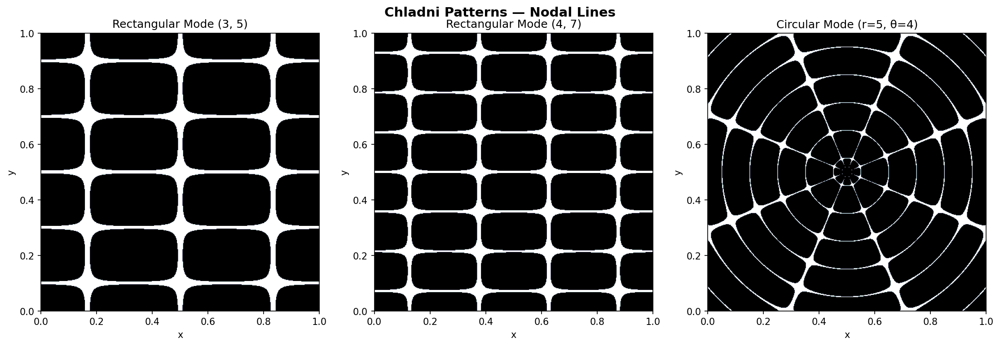
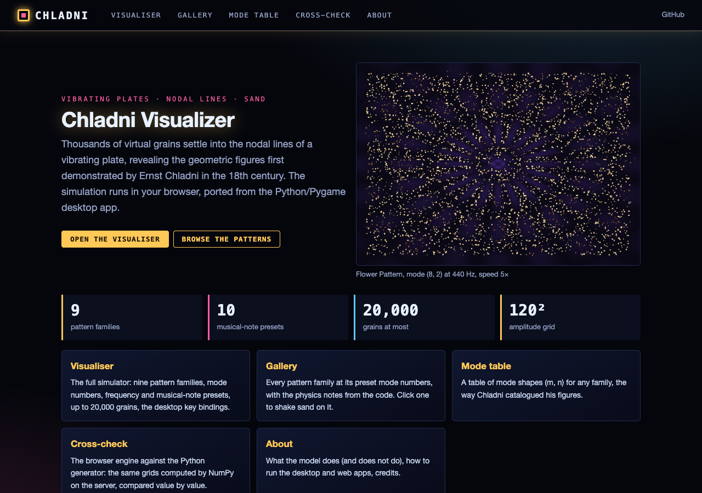
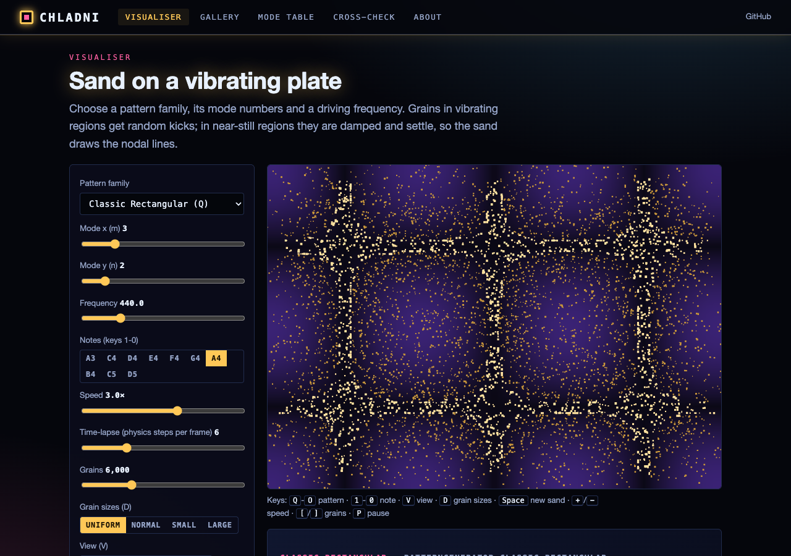
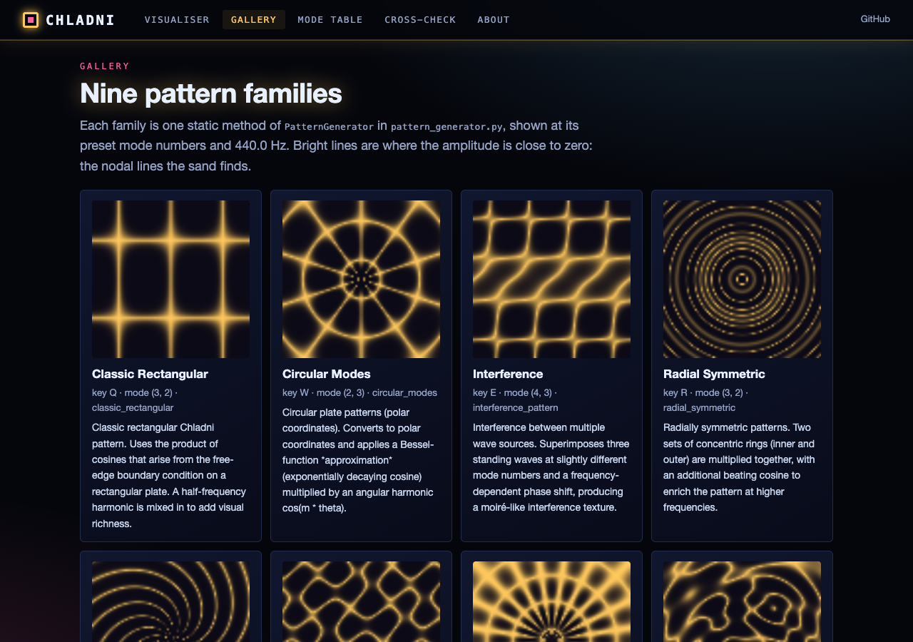
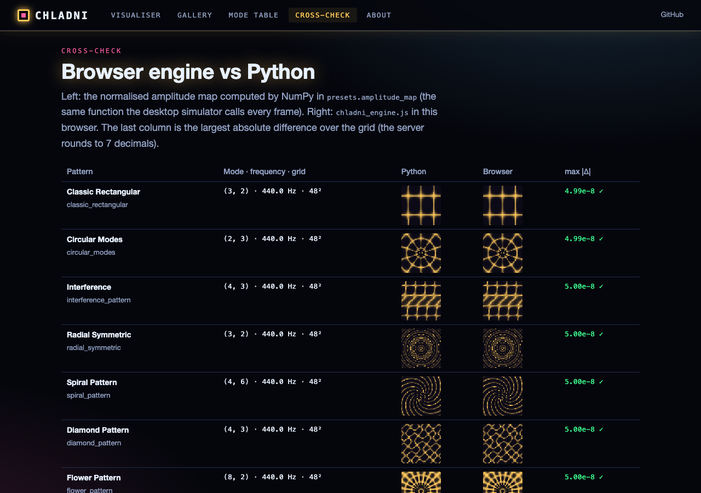

# Chladni Pattern Visualizer

An interactive real-time simulation of Chladni patterns using Pygame. Thousands of virtual particles settle into the nodal lines of vibrating plates, creating the beautiful geometric patterns first demonstrated by Ernst Chladni in the 18th century.



## Features

- **Real-time particle simulation** -- thousands of particles respond to vibration amplitude maps
- **Multiple pattern types**:
  - Classic rectangular plate modes
  - Circular plate modes (polar coordinates with Bessel function approximation)
  - Interference patterns from multiple wave sources
  - Radial symmetric patterns
- **Interactive controls**:
  - Adjust mode numbers (X/Y) with arrow keys
  - Change vibration frequency
  - Control simulation speed
  - Toggle 3D mode
  - Switch between pattern types
- **Visual customization** -- particles settle at nodal lines where vibration amplitude is minimal

## Requirements

- Python 3.7+
- pygame
- numpy

```bash
pip install pygame numpy
```

## Usage

```bash
python main.py                                  # classic rectangular pattern
python main.py --mode flower --particles 5000   # start on another pattern
```

`--mode` is one of classic, circular, interference, radial, spiral, diamond, flower, wave, superposition;
`--width`/`--height` set the window size. (`chladni_visualizer.py` is the original single-file version.)

### Controls

| Key | Action |
|-----|--------|
| Q W E R T Y U I O | Pattern presets (classic ... superposition) |
| 1 2 4 5 6 7 8 9 0 | Frequency presets / musical notes (A3 ... D5) |
| V | Cycle view: both / particles only / pattern only |
| 3 | Toggle 3D mode |
| C | Cycle 3D camera views; Left/Right: perspective angle; Page Up/Down: zoom |
| [ ] | Fewer / more particles (up to 20,000) |
| Shift + - / Shift + = | Particle size range |
| D | Cycle particle size distribution |
| + / - | Speed (Up/Down arrows: fine speed) |
| Space | Reset particles |
| Esc | Quit |

Key 3 toggles 3D mode, so the D4 (293.7 Hz) frequency preset bound to it cannot be reached from the keyboard.

## How It Works

The simulator creates an amplitude map for the selected Chladni mode pattern, then simulates particles that:
- Experience random forces in high-amplitude (vibrating) regions
- Settle via damping forces in low-amplitude (nodal) regions
- Naturally accumulate along the nodal lines, revealing the pattern

## Web version

The simulator also runs in the browser. `web/static/chladni_engine.js` is a JavaScript port of `pattern_generator.py`
(all nine pattern families), the amplitude map and `particle.py`, tested against numbers computed by the Python code.
The static site (GitHub Pages) is the full working visualiser; the local web app adds a Python API that serves the
presets and constants and computes pattern grids with the real NumPy generator for cross-checking.

| Home | Visualiser |
|---|---|
|  |  |
| **Gallery** | **Cross-check (browser vs Python)** |
|  |  |

Pages: Visualiser (pattern family, mode numbers, frequency and note presets, speed, time-lapse, up to 20,000 grains,
grain-size distribution, view mode and the desktop key bindings), Gallery, Mode table, Cross-check, About.
Not ported: the desktop 3D view (camera views, zoom, perspective).

### Run the web app

```bash
pip install -r requirements-web.txt
python run_web.py                       # http://127.0.0.1:8102
python -m pytest -q tests/test_web.py   # API, static build, JS engine (node) tests
python scripts/build_static.py          # static site in site/ (published by .github/workflows/pages.yml)
```

The node test alone: `node web/static/chladni_engine.test.mjs`. If the Python pattern or particle code changes,
refresh its reference numbers with `python scripts/engine_fixture.py --write` (`tests/test_web.py` fails until you do).

## Project Structure

```
chladni_visualizer/
├── main.py                 # Desktop entry point (CLI arguments)
├── simulator.py            # ChladniSimulator: Pygame window, rendering, input
├── particle.py             # Particle: sand-grain physics
├── pattern_generator.py    # PatternGenerator: the nine pattern families
├── presets.py              # Pattern / frequency presets and amplitude_map (shared with the web app)
├── constants.py            # Physics and display constants
├── chladni_visualizer.py   # Original single-file version (kept for reference)
├── web/                    # Web app (FastAPI) and browser front end
├── scripts/                # Static-site build, screenshots, JS test fixture
├── tests/test_web.py       # Web tests
└── examples/chladni_example.png
```

See `INTERFACE.md` for details.


---
*Built with AI assistance from [Claude (Anthropic)](https://claude.com/).*
